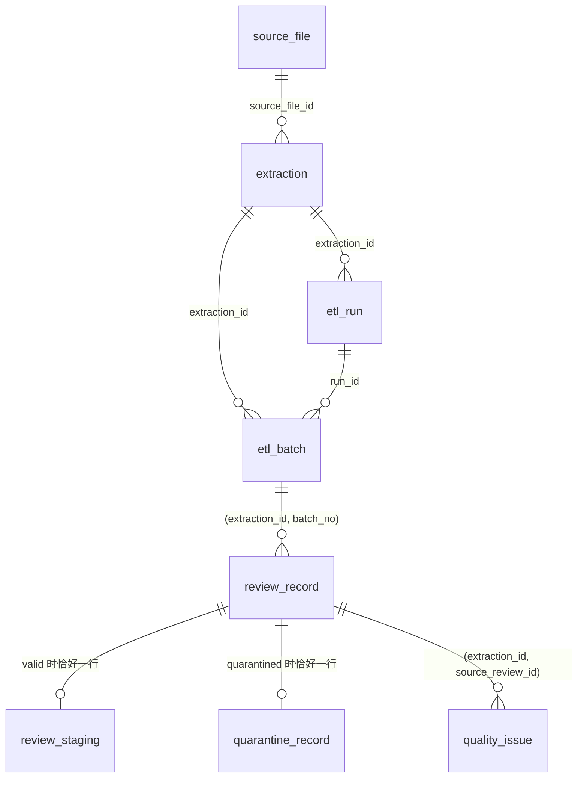

# 任务 1 字段字典

状态：2026-10-26 随 T1-03 建立，对应 `sql/001_task1_schema.sql`（schema_migration 版本 `001`）。表和约束的定义以该 SQL 为准，本文说明含义。设计理由见 [design](design.md)，规则见 [spec](spec.md)。

所有业务表以 `extraction_id` 限定同一次抽取；样本、全量与不同规则版本互不混用。`source_file_id`、`extraction_id`、`source_review_id` 等标识均为小写 64 位十六进制 SHA-256；`etl_run.run_id` 例外，为 `<Airflow run>-t<尝试号>` 或 UUID 十六进制。

## 表关系

## source_file
| 列 | 含义 |
|---|---|
| source_file_id | 压缩文件的本次实测 SHA-256，也是文件版本标识 |
| path | 校验时的文件路径（仅记录，不用于解析定位） |
| source_url | manifest 中的来源地址 |
| download_completed_at | manifest 中的下载完成时间；未知为 NULL，不以验证时间代替 |
| verified_at | 本次校验时间，与下载时间分开 |
| recorded_* / measured_* | manifest 记录值与实测的大小、SHA-256；约束要求二者一致 |
| sha256_is_official | 是否为来源方发布的官方校验值；本地计算值恒为 false |

## extraction
| 列 | 含义 |
|---|---|
| extraction_id | 源文件版本、解析版本、规则版本与有效配置的哈希 |
| parser_version / rules_version / config | 参与哈希的版本与规范化配置（含批次参数与 max_record_bytes） |
| scope / sample_max_records | `full` 无上限；`sample` 必须有上限（约束） |
| scope_complete | 声明范围已处理完 |
| source_eof_reached / gzip_verified | 是否读到源文件末尾并通过 gzip 校验；样本提前停止时为 false |
| status | `loading`、`complete`、`failed`；full 要求 EOF 与 gzip 校验才能为 complete（约束） |
| failure_reason | 失败时的异常类型与信息 |
| created_at / completed_at | 抽取登记时间与完成时间（仅 `complete` 时有值） |

## schema_migration
记录已应用的建表脚本版本（`version`）与时间（`applied_at`）；`apply_schema` 据此判断是否需要建表。

## etl_run
每次执行一行：`run_id`、`extraction_id`、可选的 `dag_id` / `airflow_run_id` / `image_digest`（后者目前运行时未填）、`program_version`（包版本、解析/规则版本、源码树哈希、Git 提交）、起止时间、状态（`running` / `succeeded` / `failed` / `reused`）、失败原因及本次提交的批次数与记录数。重复运行完全相同的输入只新增 `reused` 审计行。进程被杀留下的 `running` 记录，会在后续运行取得该抽取的锁后登记为 `failed`（原因注明进程中断）。起止时间列为 `started_at` / `finished_at`，数量列为 `batches_committed` / `records_loaded`。

## etl_batch（检查点）
| 列 | 含义 |
|---|---|
| batch_no / first_record_no / last_record_no | 批次号及覆盖的记录序号范围，批次间连续 |
| resume_offset / resume_line | 最后一条已提交记录的结束字节位置，以及其后的下一物理行号；恢复时重新扫描并核对 |
| valid_count / quarantined_count / byte_count | 本批有效、隔离记录数与原始字节数；约束要求二者之和等于范围长度 |
| batch_sha256 | 本批记录序号、ID、原始哈希与分类的摘要，用于判断"同批次同内容" |
| run_id / committed_at | 提交该批次的执行与时间 |

批次与它的全部明细在同一事务提交，所以批次行存在即代表数据已完整落库。

## review_record（所有记录）
| 列 | 含义 |
|---|---|
| source_review_id | `SHA256(source_file_id + ":" + record_no)`；不含时间或自增值 |
| record_no | 从 1 起的记录序号，隔离记录也占序号 |
| start_line / end_line | 记录的起止物理行号（从 1 开始） |
| start_offset / end_offset / byte_size | 解压流字节区间 `[start, end)`，含记录自身的行结束符，不含分隔空行；`end - start = byte_size` |
| raw_sha256 | 记录原始字节的哈希，可据定位从源文件重取核对 |
| classification | `valid` 或 `quarantined`，决定子表 |
| product_id_observed / product_id_status | R22 可明确识别的原始产品 ID，及状态 `ok` / `missing` / `blank` / `conflict` / `undecodable` |
| reviewer_id_observed / reviewer_id_status | 同上，针对用户 ID；`blank` 表示字段存在但为空或纯空白 |
| batch_no | 所属已提交批次 |

主键 `(extraction_id, source_review_id)`，另有 `(extraction_id, record_no)` 唯一。valid 记录的产品 ID 状态必须为 `ok`。

## review_staging（有效记录，一对一）
`*_raw` 为原值：缺失为 NULL，存在但为空为空字符串；规范值在非法时为 NULL，原值与问题记录仍保留。

| 列 | 含义 |
|---|---|
| product_id_raw / product_id | 产品 ID（ASIN），原样保留；不是电影 ID |
| reviewer_id_raw / reviewer_id | 用户 ID；空或纯空白的规范值为 NULL；`unknown` 等字面量保留 |
| profile_name_raw | 昵称，不作用户标识 |
| helpfulness_raw / helpful_votes / total_votes / helpfulness_ratio | 有用票原值；非负整数且分子≤分母；`0/0` 比率为 NULL；非法时三项规范值均为 NULL |
| score_raw / score | 评分原值；规范值为 1–5 的 Decimal，可含小数 |
| review_time_raw / review_time_unix / review_time_utc | 时间原值；Unix 整数秒及其 UTC 时间；非整数文本或超出 int64 时两者均为 NULL；整数合法但超出 datetime 范围时仅 UTC 时间为 NULL；均记 `invalid_review_time`，原值保留（spec R21） |
| summary_raw / review_text_raw | 摘要与正文原文，不截断、不改写 |
| field_present / field_start_lines | 八个字段是否存在、起始物理行号（JSONB），用于区分缺失与空值并支持后续血缘 |
| rules_version | 产生规范值的规则版本 |

## quarantine_record（隔离记录，一对一）
| 列 | 含义 |
|---|---|
| reasons | 隔离原因：`oversize_record`、`nul_byte`、`invalid_utf8`、`duplicate_prefix`、`unknown_line`、`missing_product_id`、`blank_product_id` |
| raw_bytes | 常规隔离记录的完整原始字节（bytea） |
| spill_path / spill_sha256 / spill_size | 超限记录的旁路文件（相对输出目录，如 `evidence/<extraction_id>/<source_review_id>.bin`）；与 raw_bytes 二选一（约束） |

旁路文件先完整落盘并校验，再由事务引用；崩溃遗留的临时文件（`oversize-*.bin`）在下次运行前清理。

## quality_issue
| 列 | 含义 |
|---|---|
| issue_key | 由记录、字段、问题码、同类序号和规则版本得到的确定性键，重试不产生重复 |
| field / code / severity | 字段键（可为空表示整条记录）、问题码、`error` / `warning` / `info` |
| evidence / details | 不超过 256 字符的原值，或非法 UTF-8 位置附近的十六进制字节；结构化细节（行号、原因等，JSONB） |
| rule_version | 产生该问题的规则版本 |

问题码：隔离类 `oversize_record`、`nul_byte`、`invalid_utf8`、`duplicate_prefix`、`unknown_line`、`missing_product_id`、`blank_product_id`；字段类 `missing_field`、`empty_user_id`、`empty_review_text`、`invalid_helpfulness`、`invalid_score`、`invalid_review_time`、`nonstandard_product_id_format`。

## 约束与核对
- 主键、外键、`CHECK` 在 SQL 中定义；valid/quarantined 互斥由复合外键 `(extraction_id, source_review_id, classification)` 保证，完备性由延迟约束触发器在提交时检查。
- `sql/task1_integrity.sql` 给出 10 项核对，`violations` 必须全为 0；通过 `etl_task1.db.run_integrity` 执行。
- 其余 ER 关系见上图；`etl_run` 与 `extraction` 之间的关系是一对多。
