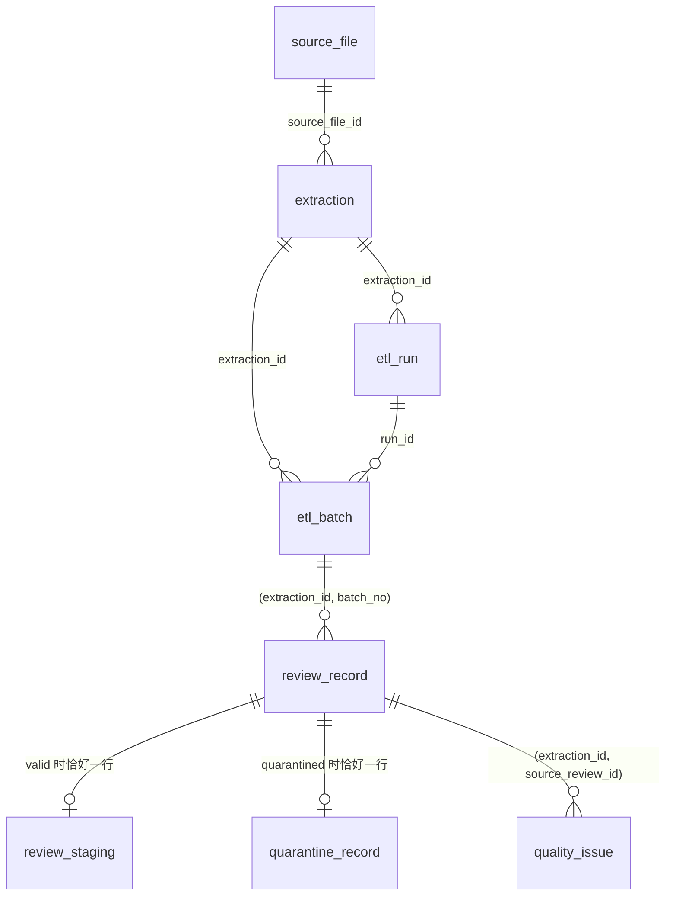

# 任务 1 字段字典

状态：2026-10-26 随 T1-03 建立，对应 `sql/001_task1_schema.sql`（schema_migration 版本 `001`）。表和约束的定义以该 SQL 为准，本文说明含义；文末附录由数据库系统目录自动生成（`python3 scripts/gen_schema_appendix.py`），列出全部列类型、可空性、默认值、约束、索引和触发器。设计理由见 [design](design.md)，规则见 [spec](spec.md)。

所有业务表以 `extraction_id` 限定同一次抽取；样本、全量与不同规则版本互不混用。`source_file_id`、`extraction_id`、`source_review_id` 等标识均为小写 64 位十六进制 SHA-256；`etl_run.run_id` 例外，为 `<Airflow run>-t<尝试号>` 或 UUID 十六进制。

## 表关系

## source_file
| 列 | 含义 |
|---|---|
| source_file_id | 压缩文件的本次实测 SHA-256，也是文件版本标识 |
| path | 校验时的文件路径（仅记录，不用于解析定位） |
| source_url | manifest 中的来源地址 |
| download_completed_at | manifest 中的下载完成时间；未知为 NULL，不以验证时间代替 |
| verified_at | 本次校验时间，与下载时间分开 |
| recorded_* / measured_* | manifest 记录值与实测的大小、SHA-256；约束要求二者一致 |
| sha256_is_official | 是否为来源方发布的官方校验值；本地计算值恒为 false |

## extraction
| 列 | 含义 |
|---|---|
| extraction_id | 源文件版本、解析版本、规则版本与有效配置的哈希 |
| parser_version / rules_version / config | 参与哈希的版本与规范化配置（含批次参数与 max_record_bytes） |
| scope / sample_max_records | `full` 无上限；`sample` 必须有上限（约束） |
| scope_complete | 声明范围已处理完 |
| source_eof_reached / gzip_verified | 是否读到源文件末尾并通过 gzip 校验；样本提前停止时为 false |
| status | `loading`、`complete`、`failed`；full 要求 EOF 与 gzip 校验才能为 complete（约束） |
| failure_reason | 失败时的异常类型与信息 |
| created_at / completed_at | 抽取登记时间与完成时间（仅 `complete` 时有值） |

## schema_migration
记录已应用的建表脚本版本（`version`）与时间（`applied_at`）；`apply_schema` 据此判断是否需要建表。

## etl_run
每次执行一行：`run_id`、`extraction_id`、可选的 `dag_id` / `airflow_run_id` / `image_digest`（后者目前运行时未填）、`program_version`（包版本、解析/规则版本、源码树哈希、Git 提交）、起止时间、状态（`running` / `succeeded` / `failed` / `reused`）、失败原因及本次提交的批次数与记录数。重复运行完全相同的输入只新增 `reused` 审计行。进程被杀留下的 `running` 记录，会在后续运行取得该抽取的锁后登记为 `failed`（原因注明进程中断）。起止时间列为 `started_at` / `finished_at`，数量列为 `batches_committed` / `records_loaded`。

## etl_batch（检查点）
| 列 | 含义 |
|---|---|
| batch_no / first_record_no / last_record_no | 批次号及覆盖的记录序号范围，批次间连续 |
| resume_offset / resume_line | 最后一条已提交记录的结束字节位置，以及其后的下一物理行号；恢复时重新扫描并核对 |
| valid_count / quarantined_count / byte_count | 本批有效、隔离记录数与原始字节数；约束要求二者之和等于范围长度 |
| batch_sha256 | 本批记录序号、ID、原始哈希与分类的摘要，用于判断"同批次同内容" |
| run_id / committed_at | 提交该批次的执行与时间 |

批次与它的全部明细在同一事务提交，所以批次行存在即代表数据已完整落库。

## review_record（所有记录）
| 列 | 含义 |
|---|---|
| source_review_id | `SHA256(source_file_id + ":" + record_no)`；不含时间或自增值 |
| record_no | 从 1 起的记录序号，隔离记录也占序号 |
| start_line / end_line | 记录的起止物理行号（从 1 开始） |
| start_offset / end_offset / byte_size | 解压流字节区间 `[start, end)`，含记录自身的行结束符，不含分隔空行；`end - start = byte_size` |
| raw_sha256 | 记录原始字节的哈希，可据定位从源文件重取核对 |
| classification | `valid` 或 `quarantined`，决定子表 |
| product_id_observed / product_id_status | R22 可明确识别的原始产品 ID，及状态 `ok` / `missing` / `blank` / `conflict` / `undecodable` |
| reviewer_id_observed / reviewer_id_status | 同上，针对用户 ID；`blank` 表示字段存在但为空或纯空白 |
| batch_no | 所属已提交批次 |

主键 `(extraction_id, source_review_id)`，另有 `(extraction_id, record_no)` 唯一。valid 记录的产品 ID 状态必须为 `ok`。

## review_staging（有效记录，一对一）
`*_raw` 为原值：缺失为 NULL，存在但为空为空字符串；规范值在非法时为 NULL，原值与问题记录仍保留。

| 列 | 含义 |
|---|---|
| product_id_raw / product_id | 产品 ID（ASIN），原样保留；不是电影 ID |
| reviewer_id_raw / reviewer_id | 用户 ID；空或纯空白的规范值为 NULL；`unknown` 等字面量保留 |
| profile_name_raw | 昵称，不作用户标识 |
| helpfulness_raw / helpful_votes / total_votes / helpfulness_ratio | 有用票原值；非负整数且分子≤分母；`0/0` 比率为 NULL；非法时三项规范值均为 NULL |
| score_raw / score | 评分原值；规范值为 1–5 的 Decimal，可含小数 |
| review_time_raw / review_time_unix / review_time_utc | 时间原值；Unix 整数秒及其 UTC 时间；非整数文本或超出 int64 时两者均为 NULL；整数合法但超出 datetime 范围时仅 UTC 时间为 NULL；均记 `invalid_review_time`，原值保留（spec R21） |
| summary_raw / review_text_raw | 摘要与正文原文，不截断、不改写 |
| field_present / field_start_lines | 八个字段是否存在、起始物理行号（JSONB），用于区分缺失与空值并支持后续血缘 |
| rules_version | 产生规范值的规则版本 |

## quarantine_record（隔离记录，一对一）
| 列 | 含义 |
|---|---|
| reasons | 隔离原因：`oversize_record`、`nul_byte`、`invalid_utf8`、`duplicate_prefix`、`unknown_line`、`missing_product_id`、`blank_product_id` |
| raw_bytes | 常规隔离记录的完整原始字节（bytea） |
| spill_path / spill_sha256 / spill_size | 超限记录的旁路文件（相对输出目录，如 `evidence/<extraction_id>/<source_review_id>.bin`）；与 raw_bytes 二选一（约束） |

旁路文件先完整落盘并校验，再由事务引用；崩溃遗留的临时文件（`oversize-*.bin`）在下次运行前清理。

## quality_issue
| 列 | 含义 |
|---|---|
| issue_key | 由记录、字段、问题码、同类序号和规则版本得到的确定性键，重试不产生重复 |
| field / code / severity | 字段键（可为空表示整条记录）、问题码、`error` / `warning` / `info` |
| evidence / details | 不超过 256 字符的原值，或非法 UTF-8 位置附近的十六进制字节；结构化细节（行号、原因等，JSONB） |
| rule_version | 产生该问题的规则版本 |

问题码：隔离类 `oversize_record`、`nul_byte`、`invalid_utf8`、`duplicate_prefix`、`unknown_line`、`missing_product_id`、`blank_product_id`；字段类 `missing_field`、`empty_user_id`、`empty_review_text`、`invalid_helpfulness`、`invalid_score`、`invalid_review_time`、`nonstandard_product_id_format`。

## 约束与核对
- 主键、外键、`CHECK` 在 SQL 中定义；valid/quarantined 互斥由复合外键 `(extraction_id, source_review_id, classification)` 保证，完备性由延迟约束触发器在提交时检查。
- `sql/task1_integrity.sql` 给出 10 项核对，`violations` 必须全为 0；通过 `etl_task1.db.run_integrity` 执行。
- 其余 ER 关系见上图；`etl_run` 与 `extraction` 之间的关系是一对多。

<!-- schema-appendix:begin（由 scripts/gen_schema_appendix.py 生成，勿手改） -->

## 附录：列类型、约束与索引

由 PostgreSQL 18.6 的系统目录自动生成（库 `etl_movies`，schema_migration 版本 001）。含义见上文，此处只列数据库实际的类型、可空性、默认值、约束、索引和触发器；与 `sql/001_task1_schema.sql` 一致。

### source_file

| 列 | 类型 | 可空 | 默认值 |
|---|---|---|---|
| `source_file_id` | `text` | 否 |  |
| `path` | `text` | 否 |  |
| `source_url` | `text` | 否 |  |
| `download_completed_at` | `timestamp with time zone` | 是 |  |
| `verified_at` | `timestamp with time zone` | 否 |  |
| `recorded_size_bytes` | `bigint` | 否 |  |
| `measured_size_bytes` | `bigint` | 否 |  |
| `recorded_sha256` | `text` | 否 |  |
| `measured_sha256` | `text` | 否 |  |
| `sha256_is_official` | `boolean` | 否 | `false` |

约束：

- 主键 `source_file_pkey`：`PRIMARY KEY (source_file_id)`
- CHECK `source_file_check`：`CHECK ((measured_size_bytes = recorded_size_bytes))`
- CHECK `source_file_check1`：`CHECK ((measured_sha256 = recorded_sha256))`
- CHECK `source_file_check2`：`CHECK ((source_file_id = measured_sha256))`
- CHECK `source_file_measured_sha256_check`：`CHECK ((measured_sha256 ~ '^[0-9a-f]{64}$'::text))`
- CHECK `source_file_measured_size_bytes_check`：`CHECK ((measured_size_bytes > 0))`
- CHECK `source_file_recorded_sha256_check`：`CHECK ((recorded_sha256 ~ '^[0-9a-f]{64}$'::text))`
- CHECK `source_file_recorded_size_bytes_check`：`CHECK ((recorded_size_bytes > 0))`
- CHECK `source_file_source_file_id_check`：`CHECK ((source_file_id ~ '^[0-9a-f]{64}$'::text))`

索引：

- `source_file_pkey`：`btree (source_file_id)`

### extraction

| 列 | 类型 | 可空 | 默认值 |
|---|---|---|---|
| `extraction_id` | `text` | 否 |  |
| `source_file_id` | `text` | 否 |  |
| `parser_version` | `text` | 否 |  |
| `rules_version` | `text` | 否 |  |
| `config` | `jsonb` | 否 |  |
| `scope` | `text` | 否 |  |
| `sample_max_records` | `bigint` | 是 |  |
| `scope_complete` | `boolean` | 否 | `false` |
| `source_eof_reached` | `boolean` | 否 | `false` |
| `gzip_verified` | `boolean` | 否 | `false` |
| `status` | `text` | 否 | `'loading'::text` |
| `failure_reason` | `text` | 是 |  |
| `created_at` | `timestamp with time zone` | 否 | `now()` |
| `completed_at` | `timestamp with time zone` | 是 |  |

约束：

- 主键 `extraction_pkey`：`PRIMARY KEY (extraction_id)`
- 外键 `extraction_source_file_id_fkey`：`FOREIGN KEY (source_file_id) REFERENCES source_file(source_file_id)`
- CHECK `extraction_check`：`CHECK (((scope = 'full'::text) = (sample_max_records IS NULL)))`
- CHECK `extraction_check1`：`CHECK (((status <> 'complete'::text) OR scope_complete))`
- CHECK `extraction_check2`：`CHECK (((status <> 'complete'::text) OR (scope = 'sample'::text) OR (source_eof_reached AND gzip_verified)))`
- CHECK `extraction_extraction_id_check`：`CHECK ((extraction_id ~ '^[0-9a-f]{64}$'::text))`
- CHECK `extraction_sample_max_records_check`：`CHECK ((sample_max_records > 0))`
- CHECK `extraction_scope_check`：`CHECK ((scope = ANY (ARRAY['full'::text, 'sample'::text])))`
- CHECK `extraction_status_check`：`CHECK ((status = ANY (ARRAY['loading'::text, 'complete'::text, 'failed'::text])))`

索引：

- `extraction_pkey`：`btree (extraction_id)`

### etl_run

| 列 | 类型 | 可空 | 默认值 |
|---|---|---|---|
| `run_id` | `text` | 否 |  |
| `extraction_id` | `text` | 否 |  |
| `dag_id` | `text` | 是 |  |
| `airflow_run_id` | `text` | 是 |  |
| `program_version` | `jsonb` | 否 |  |
| `image_digest` | `text` | 是 |  |
| `started_at` | `timestamp with time zone` | 否 | `now()` |
| `finished_at` | `timestamp with time zone` | 是 |  |
| `status` | `text` | 否 | `'running'::text` |
| `failure_reason` | `text` | 是 |  |
| `batches_committed` | `bigint` | 否 | `0` |
| `records_loaded` | `bigint` | 否 | `0` |

约束：

- 主键 `etl_run_pkey`：`PRIMARY KEY (run_id)`
- 外键 `etl_run_extraction_id_fkey`：`FOREIGN KEY (extraction_id) REFERENCES extraction(extraction_id)`
- CHECK `etl_run_status_check`：`CHECK ((status = ANY (ARRAY['running'::text, 'succeeded'::text, 'failed'::text, 'reused'::text])))`

索引：

- `etl_run_pkey`：`btree (run_id)`

### etl_batch

| 列 | 类型 | 可空 | 默认值 |
|---|---|---|---|
| `extraction_id` | `text` | 否 |  |
| `batch_no` | `integer` | 否 |  |
| `first_record_no` | `bigint` | 否 |  |
| `last_record_no` | `bigint` | 否 |  |
| `resume_offset` | `bigint` | 否 |  |
| `resume_line` | `bigint` | 否 |  |
| `valid_count` | `integer` | 否 |  |
| `quarantined_count` | `integer` | 否 |  |
| `byte_count` | `bigint` | 否 |  |
| `batch_sha256` | `text` | 否 |  |
| `run_id` | `text` | 否 |  |
| `committed_at` | `timestamp with time zone` | 否 | `now()` |

约束：

- 主键 `etl_batch_pkey`：`PRIMARY KEY (extraction_id, batch_no)`
- 唯一 `etl_batch_extraction_id_first_record_no_key`：`UNIQUE (extraction_id, first_record_no)`
- 唯一 `etl_batch_extraction_id_last_record_no_key`：`UNIQUE (extraction_id, last_record_no)`
- 外键 `etl_batch_extraction_id_fkey`：`FOREIGN KEY (extraction_id) REFERENCES extraction(extraction_id)`
- 外键 `etl_batch_run_id_fkey`：`FOREIGN KEY (run_id) REFERENCES etl_run(run_id)`
- CHECK `etl_batch_batch_no_check`：`CHECK ((batch_no >= 1))`
- CHECK `etl_batch_batch_sha256_check`：`CHECK ((batch_sha256 ~ '^[0-9a-f]{64}$'::text))`
- CHECK `etl_batch_byte_count_check`：`CHECK ((byte_count >= 0))`
- CHECK `etl_batch_check`：`CHECK ((last_record_no >= first_record_no))`
- CHECK `etl_batch_check1`：`CHECK (((valid_count + quarantined_count) = ((last_record_no - first_record_no) + 1)))`
- CHECK `etl_batch_first_record_no_check`：`CHECK ((first_record_no >= 1))`
- CHECK `etl_batch_quarantined_count_check`：`CHECK ((quarantined_count >= 0))`
- CHECK `etl_batch_resume_line_check`：`CHECK ((resume_line >= 1))`
- CHECK `etl_batch_resume_offset_check`：`CHECK ((resume_offset >= 0))`
- CHECK `etl_batch_valid_count_check`：`CHECK ((valid_count >= 0))`

索引：

- `etl_batch_extraction_id_first_record_no_key`：`btree (extraction_id, first_record_no)`
- `etl_batch_extraction_id_last_record_no_key`：`btree (extraction_id, last_record_no)`
- `etl_batch_pkey`：`btree (extraction_id, batch_no)`

### review_record

| 列 | 类型 | 可空 | 默认值 |
|---|---|---|---|
| `extraction_id` | `text` | 否 |  |
| `source_review_id` | `text` | 否 |  |
| `record_no` | `bigint` | 否 |  |
| `start_line` | `bigint` | 否 |  |
| `end_line` | `bigint` | 否 |  |
| `start_offset` | `bigint` | 否 |  |
| `end_offset` | `bigint` | 否 |  |
| `byte_size` | `bigint` | 否 |  |
| `raw_sha256` | `text` | 否 |  |
| `classification` | `text` | 否 |  |
| `product_id_observed` | `text` | 是 |  |
| `product_id_status` | `text` | 否 |  |
| `reviewer_id_observed` | `text` | 是 |  |
| `reviewer_id_status` | `text` | 否 |  |
| `batch_no` | `integer` | 否 |  |

约束：

- 主键 `review_record_pkey`：`PRIMARY KEY (extraction_id, source_review_id)`
- 唯一 `review_record_extraction_id_record_no_key`：`UNIQUE (extraction_id, record_no)`
- 唯一 `review_record_extraction_id_source_review_id_classification_key`：`UNIQUE (extraction_id, source_review_id, classification)`
- 外键 `review_record_extraction_id_batch_no_fkey`：`FOREIGN KEY (extraction_id, batch_no) REFERENCES etl_batch(extraction_id, batch_no)`
- CHECK `review_record_byte_size_check`：`CHECK ((byte_size > 0))`
- CHECK `review_record_check`：`CHECK ((end_line >= start_line))`
- CHECK `review_record_check1`：`CHECK (((end_offset - start_offset) = byte_size))`
- CHECK `review_record_check2`：`CHECK (((product_id_status = 'ok'::text) = (product_id_observed IS NOT NULL)))`
- CHECK `review_record_check3`：`CHECK (((reviewer_id_status = 'ok'::text) = (reviewer_id_observed IS NOT NULL)))`
- CHECK `review_record_check4`：`CHECK (((classification <> 'valid'::text) OR (product_id_status = 'ok'::text)))`
- CHECK `review_record_classification_check`：`CHECK ((classification = ANY (ARRAY['valid'::text, 'quarantined'::text])))`
- CHECK `review_record_product_id_status_check`：`CHECK ((product_id_status = ANY (ARRAY['ok'::text, 'missing'::text, 'blank'::text, 'conflict'::text, 'undecodable'::text])))`
- CHECK `review_record_raw_sha256_check`：`CHECK ((raw_sha256 ~ '^[0-9a-f]{64}$'::text))`
- CHECK `review_record_record_no_check`：`CHECK ((record_no >= 1))`
- CHECK `review_record_reviewer_id_status_check`：`CHECK ((reviewer_id_status = ANY (ARRAY['ok'::text, 'missing'::text, 'blank'::text, 'conflict'::text, 'undecodable'::text])))`
- CHECK `review_record_source_review_id_check`：`CHECK ((source_review_id ~ '^[0-9a-f]{64}$'::text))`
- CHECK `review_record_start_line_check`：`CHECK ((start_line >= 1))`
- CHECK `review_record_start_offset_check`：`CHECK ((start_offset >= 0))`

索引：

- `review_record_batch_idx`：`btree (extraction_id, batch_no)`
- `review_record_extraction_id_record_no_key`：`btree (extraction_id, record_no)`
- `review_record_extraction_id_source_review_id_classification_key`：`btree (extraction_id, source_review_id, classification)`
- `review_record_pkey`：`btree (extraction_id, source_review_id)`
- `review_record_product_idx`：`btree (extraction_id, product_id_observed)`
- `review_record_reviewer_idx`：`btree (extraction_id, reviewer_id_observed)`

触发器：

- `review_record_child_complete`：`CREATE CONSTRAINT TRIGGER review_record_child_complete AFTER INSERT ON public.review_record DEFERRABLE INITIALLY DEFERRED FOR EACH ROW EXECUTE FUNCTION check_review_record_child()`

### review_staging

| 列 | 类型 | 可空 | 默认值 |
|---|---|---|---|
| `extraction_id` | `text` | 否 |  |
| `source_review_id` | `text` | 否 |  |
| `classification` | `text` | 否 | `'valid'::text` |
| `product_id_raw` | `text` | 否 |  |
| `product_id` | `text` | 否 |  |
| `reviewer_id_raw` | `text` | 是 |  |
| `reviewer_id` | `text` | 是 |  |
| `profile_name_raw` | `text` | 是 |  |
| `helpfulness_raw` | `text` | 是 |  |
| `helpful_votes` | `bigint` | 是 |  |
| `total_votes` | `bigint` | 是 |  |
| `helpfulness_ratio` | `numeric(12,10)` | 是 |  |
| `score_raw` | `text` | 是 |  |
| `score` | `numeric` | 是 |  |
| `review_time_raw` | `text` | 是 |  |
| `review_time_unix` | `bigint` | 是 |  |
| `review_time_utc` | `timestamp with time zone` | 是 |  |
| `summary_raw` | `text` | 是 |  |
| `review_text_raw` | `text` | 是 |  |
| `field_present` | `jsonb` | 否 |  |
| `field_start_lines` | `jsonb` | 否 |  |
| `rules_version` | `text` | 否 |  |

约束：

- 主键 `review_staging_pkey`：`PRIMARY KEY (extraction_id, source_review_id)`
- 外键 `review_staging_extraction_id_source_review_id_classificati_fkey`：`FOREIGN KEY (extraction_id, source_review_id, classification) REFERENCES review_record(extraction_id, source_review_id, classification)`
- CHECK `review_staging_check`：`CHECK (((product_id_raw = product_id) AND (btrim(product_id) <> ''::text)))`
- CHECK `review_staging_check1`：`CHECK (((helpful_votes IS NULL) = (total_votes IS NULL)))`
- CHECK `review_staging_check2`：`CHECK (((helpful_votes IS NULL) OR (helpful_votes <= total_votes)))`
- CHECK `review_staging_check3`：`CHECK (((helpfulness_ratio IS NULL) = ((total_votes IS NULL) OR (total_votes = 0))))`
- CHECK `review_staging_check4`：`CHECK (((reviewer_id IS NULL) OR ((reviewer_id = reviewer_id_raw) AND (btrim(reviewer_id) <> ''::text))))`
- CHECK `review_staging_check5`：`CHECK (((review_time_utc IS NULL) OR (review_time_unix IS NOT NULL)))`
- CHECK `review_staging_classification_check`：`CHECK ((classification = 'valid'::text))`
- CHECK `review_staging_helpful_votes_check`：`CHECK ((helpful_votes >= 0))`
- CHECK `review_staging_helpfulness_ratio_check`：`CHECK (((helpfulness_ratio >= (0)::numeric) AND (helpfulness_ratio <= (1)::numeric)))`
- CHECK `review_staging_score_check`：`CHECK (((score >= (1)::numeric) AND (score <= (5)::numeric)))`
- CHECK `review_staging_total_votes_check`：`CHECK ((total_votes >= 0))`

索引：

- `review_staging_pkey`：`btree (extraction_id, source_review_id)`
- `review_staging_product_idx`：`btree (extraction_id, product_id)`
- `review_staging_reviewer_idx`：`btree (extraction_id, reviewer_id)`

### quarantine_record

| 列 | 类型 | 可空 | 默认值 |
|---|---|---|---|
| `extraction_id` | `text` | 否 |  |
| `source_review_id` | `text` | 否 |  |
| `classification` | `text` | 否 | `'quarantined'::text` |
| `reasons` | `text[]` | 否 |  |
| `raw_bytes` | `bytea` | 是 |  |
| `spill_path` | `text` | 是 |  |
| `spill_sha256` | `text` | 是 |  |
| `spill_size` | `bigint` | 是 |  |
| `rules_version` | `text` | 否 |  |

约束：

- 主键 `quarantine_record_pkey`：`PRIMARY KEY (extraction_id, source_review_id)`
- 外键 `quarantine_record_extraction_id_source_review_id_classific_fkey`：`FOREIGN KEY (extraction_id, source_review_id, classification) REFERENCES review_record(extraction_id, source_review_id, classification)`
- CHECK `quarantine_record_check`：`CHECK (((raw_bytes IS NOT NULL) <> (spill_path IS NOT NULL)))`
- CHECK `quarantine_record_check1`：`CHECK (((spill_path IS NULL) = ((spill_sha256 IS NULL) AND (spill_size IS NULL))))`
- CHECK `quarantine_record_classification_check`：`CHECK ((classification = 'quarantined'::text))`
- CHECK `quarantine_record_reasons_check`：`CHECK ((cardinality(reasons) >= 1))`
- CHECK `quarantine_record_spill_sha256_check`：`CHECK ((spill_sha256 ~ '^[0-9a-f]{64}$'::text))`
- CHECK `quarantine_record_spill_size_check`：`CHECK ((spill_size > 0))`

索引：

- `quarantine_record_pkey`：`btree (extraction_id, source_review_id)`

### quality_issue

| 列 | 类型 | 可空 | 默认值 |
|---|---|---|---|
| `extraction_id` | `text` | 否 |  |
| `issue_key` | `text` | 否 |  |
| `source_review_id` | `text` | 否 |  |
| `field` | `text` | 是 |  |
| `code` | `text` | 否 |  |
| `severity` | `text` | 否 |  |
| `evidence` | `text` | 是 |  |
| `details` | `jsonb` | 否 | `'{}'::jsonb` |
| `rule_version` | `text` | 否 |  |

约束：

- 主键 `quality_issue_pkey`：`PRIMARY KEY (extraction_id, issue_key)`
- 外键 `quality_issue_extraction_id_source_review_id_fkey`：`FOREIGN KEY (extraction_id, source_review_id) REFERENCES review_record(extraction_id, source_review_id)`
- CHECK `quality_issue_issue_key_check`：`CHECK ((issue_key ~ '^[0-9a-f]{64}$'::text))`
- CHECK `quality_issue_severity_check`：`CHECK ((severity = ANY (ARRAY['error'::text, 'warning'::text, 'info'::text])))`

索引：

- `quality_issue_code_idx`：`btree (extraction_id, code)`
- `quality_issue_pkey`：`btree (extraction_id, issue_key)`
- `quality_issue_record_idx`：`btree (extraction_id, source_review_id)`

### schema_migration

| 列 | 类型 | 可空 | 默认值 |
|---|---|---|---|
| `version` | `text` | 否 |  |
| `applied_at` | `timestamp with time zone` | 否 | `now()` |

约束：

- 主键 `schema_migration_pkey`：`PRIMARY KEY (version)`

索引：

- `schema_migration_pkey`：`btree (version)`

<!-- schema-appendix:end -->
