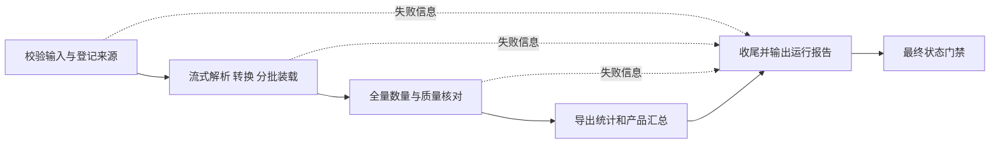

 # 任务 1 设计思路

状态：第一轮设计，2026-10-22 从原 spec 拆分整理。沿用已讨论方案，不表示已经实现或完成环境验证。需求、可观察行为和 AC 以 [spec](spec.md) 为准；本文解释如何实现及选择理由。

## 整体思路

把文件读取、记录解析与校验做成可独立测试的 Python 核心，再由 Airflow 组织执行。流式读取和有限批次控制内存；PostgreSQL 同时承载暂存结果、质量问题和恢复凭据。先用固定样本验证语义与事务，再试跑评估资源，最后执行全量。

原始文件保留在原位置并只读挂载。文件哈希界定输入版本，记录定位保留原始证据，抽取 ID 区分规则与配置，每次运行另有审计 ID。这样可以区分“相同数据重试”与“规则变化后重算”，避免把重跑误当新增评论。

## 输入依据与环境快照

以下为 2026-10-21 规划时读取的文件和环境信息，不是 2026-10-22 的全量复核或容量测量。

- 任务依据：[ETL 作业说明](../../../作业/数据存储与管理_ETL作业说明.docx)，重点为任务 1、第五部分评论字段、第八部分架构与恢复、第十部分数量与可复现要求。
- 工具依据：[ETL 课件](../../../ETL.pdf)，PDF 第 29 页“开源工具处于不同架构层次”（页面页脚为 30）列有 Airflow，职责是工作流编排。
- 原始文件：[movies.txt.gz](../../../movies.txt.gz)，现有大小 3,321,791,660 字节，约 3.32 GB / 3.09 GiB。
- 已有旁路记录：[下载元数据](../../../movies.txt.gz.download.json)、[校验值文件](../../../movies.txt.gz.sha256)。下载记录写明完成时间为 `2026-10-21T10:25:40.110232+08:00`，来源为 `https://snap.stanford.edu/data/movies.txt.gz`。
- 旁路记录中的 SHA-256 为 `4b6ee09ea4880f3fb197b1407d45dfb08a892fbb48a9e7a2d74aa0572cdcc715`。其中的 gzip 检查结果属于已有下载记录，本次计划阶段未重新进行全文件哈希或完整性校验；实施时必须复核。该值不是 SNAP 发布的独立官方校验值。
- 已知开发机为 macOS arm64，24 GiB 物理内存；规划时可用磁盘约 158 GiB。宿主机 Python 为 3.14.6，项目以容器内环境为准。尚未验证可用的 Docker 服务或 PostgreSQL 实例。

## 技术选择与部署

Python 负责字节解析和转换，PostgreSQL 负责约束、批量装载和事务，Airflow 负责依赖与状态；这三者职责分开。Docker Compose 固定环境和路径映射，减少换机器复现的差异。单机任务使用 LocalExecutor，避免引入当前不需要的分布式组件。

| 部分 | 选择 | 约束 |
|---|---|---|
| 解析与转换 | Python 3.12，标准库 `gzip`、`hashlib`、`decimal`、`datetime` | 二进制流划分记录，显式解码；不使用全量 DataFrame |
| 数据库 | PostgreSQL 18 | 业务数据保存在 `etl_movies`；Airflow 元数据库为独立的 `airflow_meta` |
| 数据库驱动 | Psycopg 3 | `COPY FROM STDIN` 写临时暂存表，再在同一事务内合并并登记检查点 |
| 流程编排 | Airflow 3.3.2，LocalExecutor | 单机、手动触发、`max_active_runs=1`，重型装载任务并发数为 1 |
| 环境 | Docker Compose v2，Linux arm64 容器 | 原文件只读挂载，数据库使用持久卷，开发环境只对本机开放端口 |
| 检查 | pytest、SQL 核对、真实 PostgreSQL 集成测试 | 固定小样本、故障注入、全量运行分别记录证据 |

Python 3.12、PostgreSQL 18 在所选 Airflow 版本的兼容范围内。参考镜像选用 `apache/airflow:3.3.2-python3.12`；实施环境任务须验证 arm64 构建，固定实际镜像摘要、PostgreSQL 小版本、Psycopg 与测试依赖版本。当前没有依赖锁文件或已验证的镜像拉取结果，不能使用“已锁定环境”的表述。

Compose 计划包含 PostgreSQL、一次性初始化、Airflow API 服务、scheduler 和 dag processor；本阶段无需 Celery、Redis 或 Kubernetes。ETL Python 包装入统一镜像，由 Airflow 调用；测试通过专用 `etl-test` 服务运行。Airflow 元数据与业务数据即使使用同一 PostgreSQL 服务，也必须使用不同数据库和角色；测试使用独立测试数据库。

## 输入版本与原始证据

### 输入管理

优先复用现有文件，不重复下载。配置通过 `SOURCE_GZIP_PATH`、`SOURCE_MANIFEST_PATH` 指定路径，宿主路径不得写死在解析代码中。容器将输入映射到只读位置。校验时实测大小和 SHA-256，与旁路记录比较，分别保存“记录值”和“本次实测值”。来源时间未知时保留未知，不能用本次验证时间冒充下载时间。

哈希不符、缺少输入、缺少必要来源信息时，校验任务失败并记录原因，不开始业务装载。全量抽取必须读取至 EOF，验证 gzip 完整性；尾部 CRC/长度错误使本次抽取失败，已经提交的批次保留为未完成运行的数据，不能发布成功报告。样本模式可在明确范围结束时停止，但必须分别记录 `scope_complete`、`source_eof_reached` 和 `gzip_verified`，未到 EOF 不能声称本次验证了整份压缩流。

### 三类标识

1. `source_file_id`：压缩文件本身的 SHA-256，小写 64 位十六进制。
2. `source_review_id`：`SHA256(ASCII(source_file_id + ":" + record_no))`，结果为小写 64 位十六进制。`record_no` 从 1 开始，按文件记录顺序编号；隔离记录也占编号。ID 不含运行时间、批次号或数据库自增值。
3. `extraction_id`：源文件版本、解析版本、规范化规则版本及有效配置的规范化序列化结果的哈希。有效配置包括编码、样本范围及批次参数，排除密码、日志路径等无关信息。同一配置重跑复用此 ID；每次执行另有独立 `run_id`。

固定输入、规则与配置的重跑不能创建重复结果。新规则或不同样本范围使用不同 `extraction_id`，历史结果按版本隔离；所有查询必须显式选定该 ID。不同文件压缩方式或压缩头改变会改变文件 ID，这是按源文件版本标识的预期行为。程序版本另外记录包版本和 Git commit；尚无 Git 时记录实际源码树校验值，不能用手填版本号代替代码依据。

同一内容出现在两个记录序号上，应生成两个不同 `source_review_id`，两条都保留；源记录 ID 与未来任务 8 的逻辑评论 ID 是两回事。

### 原始定位

每条记录保存 `record_no`、起止物理行号（从 1 开始）、解压后字节区间 `[start_offset, end_offset)` 和记录原始字节 SHA-256。字节区间包含记录自身行结束符，不包含分隔空行；最后一行无换行时也可定位。记录的原始证据是不可变 gzip 文件加定位信息，不要求为全量记录再复制一份完整原文文件。

正常记录保留八个字段的原始值；隔离记录额外保存原始字节或完整的可校验二进制旁路文件。原文重取工具必须能按记录定位恢复原始字节并核对哈希。解析规则调整若改变边界或编号，必须作为不兼容变更重新检查映射，不能复用旧定位悄悄覆盖。

## 解析与转换的职责

读取器按有界二进制块解压并维护行号、字节位置；解析器按 spec 的 R03/R13 划分记录、识别前缀；转换器按 R05/R07 及 R14–R21 分类并生成原值、规范值和问题。先保留字节再解码，才能在非法编码或 NUL 出现时回放原文，而不只得到被替换的文本。

每个记录块产生一个带序号的结果，装载器不能直接跳过解析异常。即使正文不能解码，仍单独尝试提取唯一、无歧义的产品/用户 ID，供 observed 统计使用；歧义 ID 不猜测取值。字段存在性和起始行随记录保存，以区分空值和缺失并支持后续字段血缘。

超长记录采用完整旁路文件保存，文件先完整落盘，再由数据库事务引用；失败产生的未引用文件不视为已完成记录。读取器避免无限长 readline；工作缓冲阈值与旁路策略见下文。字段规则不在这里重复维护，以 spec 为唯一依据。

## 暂存模型

以下是任务 1 的逻辑表，DDL、索引、ER 图和完整字段字典在实施任务中生成。本阶段不创建 Movie 或 Person，也不把 ASIN 当电影 ID。

| 表 | 关键内容与关系 |
|---|---|
| `source_file` | 文件 ID、路径、来源 URL、下载与验证时间、记录/实测大小与哈希、完整性状态 |
| `extraction` | 抽取 ID、源文件、规则与配置、full/sample 范围、scope_complete、source_eof_reached、gzip_verified、质量状态；指向 `source_file` |
| `etl_run` | 每次执行的 run_id、Airflow dag/run 标识、程序版本、镜像/依赖摘要、起止时间、状态、失败原因 |
| `etl_batch` | 抽取 ID、批次号、记录序号范围、下一读取位置、有效/隔离数、字节数、提交时间、执行 run_id |
| `review_record` | 所有记录的稳定 ID、定位、原始哈希、valid/quarantined 分类、可明确提取的原始产品/用户 ID、首次装载批次 |
| `review_staging` | 有效记录的八个原始字段、字段存在性/位置、规范值、规则版本；与 `review_record` 一对一 |
| `quarantine_record` | 隔离记录的原因、原始字节 `bytea` 或完整旁路文件引用；与 `review_record` 一对一 |
| `quality_issue` | 字段、问题码、严重程度、证据和规则版本；指向对应记录，可一对多 |

`review_record` 主键为 `(extraction_id, source_review_id)`，并对 `(extraction_id, record_no)` 建唯一约束。两个子表使用同样的复合主键和外键；批次主键为 `(extraction_id, batch_no)`，记录通过该键关联已提交批次。有效记录必须且只能有暂存子行，隔离记录必须且只能有隔离子行；通过装载事务与验收 SQL 验证互斥、完备性。质量问题使用确定性问题键，重试不产生重复问题。

暂存字段命名沿用原计划：`product_id_raw` / `product_id`、`reviewer_id_raw`、`profile_name_raw`、`helpfulness_raw` / `helpful_votes` / `total_votes` / `helpfulness_ratio`、`score_raw` 及 Decimal 规范值、`review_time_raw` / `review_time_unix` / `review_time_utc`、`summary_raw`、`review_text_raw`。规范值范围与异常行为由 spec 的 R16–R21 定义。

评分、票数范围、非负序号、字节区间及源关系由数据库约束保护。规范字段允许 NULL，但违反规则的非空值不能入库。产品和用户标识采用区分大小写的文本比较。按抽取 ID、产品和用户设计必要索引；不为全文大字段建立无用途索引。JSONB 仅用于结构化配置、问题详情等扩展数据，主要业务字段和查询关系使用明确的列及键。

## 分批装载与恢复

将结果与检查点放在同一个事务中，是为了排除“数据库已经装载但进度未登记”以及“进度登记了但数据未提交”的不一致。恢复以数据库提交凭据为准，不能只相信客户端是否收到成功响应。

初始批次上限为 10,000 条或 32 MiB 原始记录字节，先达到者触发提交。单条超过 32 MiB 的记录采用完整旁路隔离；这是资源保护的初始配置，必须在报告中说明，调整时形成不同有效配置。读取器采用有界块，避免单次 `readline()` 为极长行无限分配内存。

每批通过 Psycopg 的参数适配和 `COPY FROM STDIN` 写临时表，然后在一个 PostgreSQL 事务中完成记录、暂存/隔离、质量问题及批次检查点写入。客户端连接传输数据，不要求数据库容器访问宿主原始文件。不得手工拼接 SQL 值，也不得启用静默跳过坏行的装载选项。

提交成功才推进检查点。检查点至少包括源文件哈希、抽取 ID、最后已提交记录序号、下一解压字节位置、下一物理行号及累计计数。批次统计以已提交明细汇总为准，不把失败尝试的计数再次累加。

恢复前重新校验输入和配置。普通 gzip 的压缩偏移不能直接当作记录恢复位置；初版允许从头顺序解压并扫描到检查点，但跳过已经提交的数据装载。扫描过程计入恢复耗时，不承诺随机访问。已读取但未提交的整批在重启后重新处理。

重复运行完全相同的输入与配置时，验证已完成状态与统计后复用结果，记录新的执行审计；不重复插入评论、问题或批次。部分完成时继续未完成批次。冲突键只有在记录哈希和规则一致时才能视为已处理，不能用无条件 `ON CONFLICT DO NOTHING` 掩盖不一致。

使用数据库锁防止同一抽取被多个装载器同时写入，并以 Airflow 并发限制保护单机资源。故障测试至少覆盖提交前失败、提交后客户端未收到确认、末尾 gzip 校验失败和数据库短暂断连。数据库确认提交但客户端未知时，恢复必须查批次凭据，不能凭内存状态判断。

## Airflow 编排与收尾

计划 DAG 名为 `amazon_reviews_task1`，手动触发且不做历史补跑。主流程如下：



任务 ID 为 `verify_source`、`extract_load`、`validate_counts`、`export_results`、`finalize_report` 和 `run_gate`。收尾任务无论上游成功或失败都运行；最后的状态门禁检查整体结果，避免成功执行的收尾任务掩盖上游失败。

Airflow 只在任务间传递抽取 ID、运行 ID、文件位置和小型统计，不传递评论正文或整批数据。重试只用于数据库暂时不可用等可恢复基础设施问题，初始最多 2 次、间隔 60 秒；确定性输入错误与数量差异不盲目重试。单条数据异常按分类规则处理，不中止全文件。

可配置项包括来源路径、manifest 路径、批次行数/字节数、编码、输出位置、样本范围和测试故障注入开关。正常配置禁止故障注入。`scope=full` 不允许记录数上限；`scope=sample` 必须记录范围，报告显著标明样本，不能拿样本数量与全量基准直接判等。样本成功门禁要求声明范围处理完成且不变量成立；全量成功还要求 EOF、gzip 验证与全量核对完成。普通样本报告不默认套用固定夹具的预期数字。

## 统计与报告实现

数量守恒以 spec 的 R06 为准，统计范围、报告项和全量对照按 R22–R24 执行。SQL 显式筛选 extraction_id，从记录明细汇总，核对有效/隔离子表和批次账目；产品和用户同时输出 observed 与 valid 两组结果。不能只查有效表就声称已经核对全文件。

报告字段映射：`records_read`、`records_valid`、`records_quarantined`、`records_with_quality_issues` 对应读取、有效、隔离和有问题的记录数；`distinct_products_observed` / `distinct_users_observed` 与 `distinct_products_valid` / `distinct_users_valid` 对应两组 ID 去重数；`user_id_missing` / `user_id_empty` 分别记录缺失与空白用户，`records_removed_by_dedup` 本阶段为 0。问题行数与 ID 无法识别数量另列，具体口径仍以 spec 为准。

报告使用临时文件写完后原子替换，避免半份文件被视作成功结果；失败收尾也输出已知原因和最后提交位置。数据库不可用时至少保留 Airflow 日志或本地失败报告。最终 run_gate 检查流程状态，报告生成成功本身不能证明数据成功。

## 资源预算与运行策略

以下均为初始预算，不是已测得的性能或硬性课程指标：Docker 先分配 4 个 CPU、8 GiB 内存，抽取并发为 1，解析进程峰值 RSS 目标不超过 1 GiB。32 MiB 是批次原始字节上限，Python 对象、字段转换、COPY 缓冲与数据库另占内存，不能用该值冒充总内存用量。

任务 1 暂预留 80 GiB 可用空间作为初始工作预算，覆盖数据库表/索引、WAL、镜像、日志与隔离证据；不预先解压保存整份文本。全量运行前以不少于 100,000 条真实记录试跑，测量实际数据库增长、隔离证据增长和运行峰值，重新估算：

```text
预计表与索引大小 = 样本实测字节 / 样本记录数 × 全量记录数
磁盘工作需求 = 原始文件 + 镜像 + 预计表与索引 + 隔离证据 + WAL及临时空间 + 余量
预计装载时间 = 样本解析装载秒数 / 样本记录数 × 全量记录数
预计总时间 = 完整文件校验时间 + 预计装载时间 + 数量/索引核对时间 + 余量
```

说明前缀样本并非全量随机样本，文本长度、异常率和索引增长可能变化；保留余量并记录估算依据，不能预先承诺固定分钟数。运行时记录 RSS、累计字节、处理速率、数据库大小和磁盘可用量；空间接近保留阈值（初始 10 GiB）时安全停止，保留最后提交批次。Docker 磁盘配额与宿主剩余空间都需检查。

资源试跑与故障测试使用独立测试/基准数据库；正式全量结果不能混入样本数据。实施完成后用真实测量替换预算栏，同时保留初始估算与差异说明。

## 交付组织与验证顺序

计划交付 Python 包、锁定依赖、Dockerfile 与 Compose、Airflow DAG、建表 SQL、查询 SQL、固定测试样本及预期结果、字段字典和 ER 图、运行说明、任务 1 报告。本轮仅创建计划文档，以上实现文件尚未存在。

每次执行计划输出到 `outputs/task1/<extraction_id>/<run_id>/`：输入 manifest、机器可读 `summary.json`、可阅读 `report.md`、资源记录、质量问题分布、失败或恢复信息。成功的全量运行另外导出不同产品汇总 `distinct_products.csv`，供任务 2 接续；这不是已采集页面清单，不附伪造的采集成功状态。

产品汇总包括产品 ID、全部/有效/隔离记录数、首次/末次记录号和 ID 格式问题；从完整 observed 口径生成。异常明细、原始证据位置和运行日志都必须可定位。报告说明本次使用 AI 辅助编程/计划的范围及人工核验方式，AI 输出不作为数据事实来源。

只有固定样本、真实数据库装载、重复运行、恢复、Airflow 失败状态测试以及正式全量核对都有证据后，才能标记任务 1 实现完成。计划完成、环境可用、样本通过和全量通过是不同状态。

验证顺序为核心逻辑固定样本、真实数据库事务与恢复、实际 Airflow 成败流程、资源试跑、正式全量和复现。对应任务见 tasks，案例定义在 spec；checklist 只登记实际完成情况。实施时将字段字典、ER 图、runbook 和任务报告放在本轮 `doc/task1/` 下；它们是后续产物，当前只有四份计划文档。

## 技术依据

- [SNAP 数据规模与字段格式](https://snap.stanford.edu/data/web-Movies.html)：全量对照基准和八个源字段。
- [Python 3.12 gzip](https://docs.python.org/3.12/library/gzip.html)：文件式流读取和 gzip 错误处理。
- [Airflow 3.3.2 运行前提](https://airflow.apache.org/docs/apache-airflow/3.3.2/installation/prerequisites.html)：所选 Python 与数据库版本兼容范围。
- [Airflow executor](https://airflow.apache.org/docs/apache-airflow/3.3.2/core-concepts/executor/index.html)：本地执行器与单机部署职责。
- [Airflow 官方镜像](https://airflow.apache.org/docs/docker-stack/index.html)：版本化 Python 镜像与 AMD/ARM 支持。
- [Psycopg COPY](https://www.psycopg.org/psycopg3/docs/basic/copy.html)：按行适配、COPY 和事务行为。
- [PostgreSQL bytea](https://www.postgresql.org/docs/18/datatype-binary.html)：保留非法编码或 NUL 等原始字节。
- [PostgreSQL INSERT](https://www.postgresql.org/docs/18/sql-insert.html)：唯一约束冲突处理；项目仍须检查内容一致性。

查阅日期为 2026-10-21。实现时如更换基础版本，应重新验证兼容性、更新版本锁定记录，并同步更新 spec 与 design。
